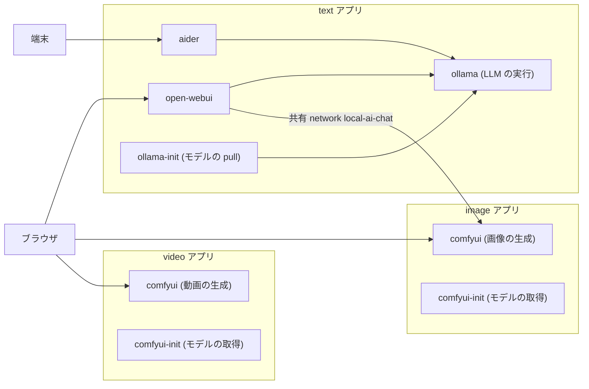
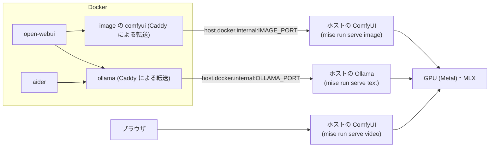

# local-ai-chat

手元のマシンで生成 AI のモデルを動かす環境です。LLM はブラウザのチャット画面 ([Open WebUI](https://github.com/open-webui/open-webui)) と端末で動く AI コーディングアシスタント ([aider](https://aider.chat/)) から、画像と動画の生成は [ComfyUI](https://github.com/Comfy-Org/ComfyUI) から使います。Claude Code や Codex が安全フィルターで断るタスク (セキュリティ研究・exploit の分析・センシティブな創作など) に使うため、拒否を減らした LLM を中心に収録しています。

環境は、text (LLM)・image (画像の生成)・video (動画の生成) の 3 つのアプリに分かれています。アプリはそれぞれ独立した Docker Compose の project で、単独でも組み合わせても起動できます。text と image の両方を起動していれば、Open WebUI のチャットから画像も生成できます。



操作は [mise](https://mise.jdx.dev/) のタスク (`mise run <task>`) で行います。どのアプリにもあるタスクは `mise run up image gpu` のようにアプリを引数に取り、1 つのアプリだけのタスクは `mise run text:code` のように `<app>:` で始まる名前です。

| アプリ           | サービス       | 動いている期間                                                                                            |
| ---------------- | -------------- | --------------------------------------------------------------------------------------------------------- |
| `text`           | `ollama`       | 起動から停止まで                                                                                          |
| `text`           | `open-webui`   | 起動から停止まで                                                                                          |
| `text`           | `ollama-init`  | 起動時と `mise run pull text` の実行時に動き、モデルの pull を終えると止まる                              |
| `text`           | `aider`        | `mise run text:code` の実行中だけ                                                                         |
| `image`          | `comfyui`      | 起動から停止まで (Apple Silicon の構成では、ComfyUI はホストで動き、このサービスはそこへの転送だけを行う) |
| `video`          | `comfyui`      | 起動から停止まで (Apple Silicon の構成では、コンテナではなくホストで動く)                                 |
| `image`・`video` | `comfyui-init` | 起動時と `mise run pull <app>` の実行時に動き、モデルの取得を終えると止まる                               |

## 必要なもの

| 対象                               | 必要なもの                                                                                                                                                                                                     |
| ---------------------------------- | -------------------------------------------------------------------------------------------------------------------------------------------------------------------------------------------------------------- |
| すべて                             | Docker Compose v2、mise                                                                                                                                                                                        |
| モデルを置くディスク               | text は全モデルで約 360GB (Apple Silicon の構成では約 380GB)、image は約 21GB、video は約 18GB                                                                                                                 |
| image と video                     | NVIDIA GPU か Apple Silicon の Mac (GPU を使わない構成は無い)                                                                                                                                                  |
| NVIDIA GPU を使う                  | NVIDIA Container Toolkit。image と video は、RTX 20 系 (Turing) 以降の GPU と CUDA 13.0 に対応したドライバー                                                                                                   |
| Apple Silicon の Mac で GPU を使う | macOS 14 以降、Docker Desktop か OrbStack、`!reset` タグに対応した Docker Compose (`docker compose -f apps/text/compose.yaml -f apps/text/compose.apple.yaml config --quiet` がエラーなく終われば対応している) |

使うモデルが載るメモリも要ります。モデルごとの目安は「[モデル一覧](docs/models.md#モデル一覧)」にあります。複数のアプリを同時に動かすと、同じ GPU のメモリを取り合います。Docker Desktop で Ollama をコンテナで動かすときは、Docker Desktop の VM にそのメモリを割り当ててください (既定はホストの 50%)。

## 起動と停止

初回だけ、ツールを入れて git の hook を設定します。

```sh
mise trust && mise install
```

使うアプリを、マシンに合わせて起動します。停止は `mise run down <app>` で、アプリを省くとすべてのアプリを止めます。

| マシン                             | text                                                                                | image                   | video                   |
| ---------------------------------- | ----------------------------------------------------------------------------------- | ----------------------- | ----------------------- |
| GPU を使わない                     | `mise run up text`                                                                  | 非対応                  | 非対応                  |
| NVIDIA GPU のあるマシン            | `mise run up text gpu`                                                              | `mise run up image gpu` | `mise run up video gpu` |
| Apple Silicon の Mac で GPU を使う | 「[Apple Silicon の Mac で GPU を使う](#apple-silicon-の-mac-で-gpu-を使う)」の手順 | 同じ                    | 同じ                    |

起動すると、そのアプリの `models.txt` (`apps/text/models.txt` など) のモデルの取得がバックグラウンドで始まります。進み具合は `mise run logs <app>` で見られます。

| アプリ           | 取得したモデルの扱い                                                                                                                                                                                 |
| ---------------- | ---------------------------------------------------------------------------------------------------------------------------------------------------------------------------------------------------- |
| `text`           | 固定した版 (digest) と一致したものだけが `qwen35-4b-heretic` のような短い名前 (エイリアス) で登録される (「[digest の照合](docs/models.md#digest-の照合)」)。`ready: <alias>` と出たモデルから使える |
| `image`・`video` | Hugging Face の固定した commit から取得し、sha256 が一致したものだけを ComfyUI のモデル置き場 (`data/<app>/comfyui/models`) に置く。`ready: <directory>/<file>` と出たファイルから使える             |

起動したら、次のものから使います。各タスクの詳細は「[タスク一覧](#タスク一覧)」にあります。

| 使うもの           | 入口                                            | 既定の接続先                                        |
| ------------------ | ----------------------------------------------- | --------------------------------------------------- |
| Open WebUI         | `mise run ui text`                              | http://localhost:3000                               |
| aider              | `mise run text:code` (端末からコードを編集する) | —                                                   |
| Ollama の API      | —                                               | http://localhost:11434 (OpenAI 互換の API は `/v1`) |
| 画像生成の ComfyUI | `mise run ui image`                             | http://localhost:8188                               |
| 動画生成の ComfyUI | `mise run ui video`                             | http://localhost:8189                               |

### 画像を生成する

Open WebUI のチャットから生成するには、一度だけ `mise run image:connect-webui` を実行して、Open WebUI の画像生成を image アプリの ComfyUI につなぎます。text アプリを起動した状態で実行し、image アプリは後から起動してもかまいません。以後は、メッセージの入力欄の Integrations のメニューで Image を有効にし、作りたい画像を頼みます。Open WebUI は、`apps/image/open-webui.json` の workflow で Z-Image Turbo を使って生成します。

ComfyUI の画面 (`mise run ui image`) からは、workflow を組んだり調整したりしながら生成できます。生成した画像は `data/image/comfyui/output` に残ります。

### 動画を生成する

ComfyUI の画面 (`mise run ui video`) から生成します。Open WebUI の動画生成は ComfyUI に接続できないので、チャットからは使えません。左のメニューの Templates から「Wan 2.2 5B Video Generation」を開くと、取得済みのモデルを使う workflow が読み込まれます。生成した動画は `data/video/comfyui/output` に残ります。

### Apple Silicon の Mac で GPU を使う

macOS の Docker のコンテナからは GPU (Metal) を使えません。そのため、この構成では Ollama と ComfyUI をホストで動かします。コンテナの `ollama` と image アプリの `comfyui` は、ホストのサーバーへ転送するだけになります。Open WebUI・aider からの接続先は、ほかの構成と変わりません。video アプリのコンテナではモデルの取得だけが動きます。



| 項目                | ほかの構成                                              | この構成                                                                                                                                         |
| ------------------- | ------------------------------------------------------- | ------------------------------------------------------------------------------------------------------------------------------------------------ |
| Ollama の版         | コンテナのイメージ                                      | `mise install` が入れた、イメージと同じ版                                                                                                        |
| ComfyUI の版        | `apps/shared/comfyui/compose.yaml` の `COMFYUI_VERSION` | 同じ版を `mise run serve <app>` が初回と版の変更時に `data/<app>/comfyui-runtime` へ入れる (Python と依存は `mise install` が入れた uv で入れる) |
| モデルの置き場      | `data/text/ollama/models`・`data/<app>/comfyui/models`  | 同じ (構成を切り替えても取得し直さない)                                                                                                          |
| ollama.com の認証鍵 | `data/text/ollama`                                      | `data/text/ollama/home` (ホストのユーザーのサインイン状態は使わない)                                                                             |
| `mlx` を付けた LLM  | pull しない                                             | pull する (Ollama の library に MLX 形式しか無いモデル)                                                                                          |
| `BIND_HOST`         | 任意                                                    | text と image は loopback を含むアドレスだけ (`127.0.0.1`・`0.0.0.0`・`::1`・`::` など)。コンテナがホストの loopback 経由で接続するため          |

| 手順 | 端末              | 操作                                                                                                                                                                                                                                                    |
| ---- | ----------------- | ------------------------------------------------------------------------------------------------------------------------------------------------------------------------------------------------------------------------------------------------------- |
| 1    | どれか            | 同じアプリをほかの構成で起動していれば `mise run down <app>` で止める。text なら Ollama.app などのほかの Ollama も止める。アプリのポート (`OLLAMA_PORT`・`IMAGE_PORT`・`VIDEO_PORT`) を使うものが動いていると、起動に失敗するか、そちらに接続してしまう |
| 2    | アプリごとに 1 つ | `mise run serve <app>` でホストのサーバーを起動する。Ollama は `Listening on`、ComfyUI は `To see the GUI go to` と出たら起動済みで、この端末は開いたままにする。ComfyUI の初回は依存の導入に数分かかる                                                 |
| 3    | ほかの端末        | `mise run up <app> apple` を実行する                                                                                                                                                                                                                    |
| 停止 | 両方              | `mise run down <app>` を実行し、`mise run serve <app>` の端末で Ctrl-C を押す。ほかの構成に戻すときは、両方を止めてからその構成で起動する                                                                                                               |

この構成で pull した MLX 形式の LLM は、ほかの構成に戻すと選択肢に残りますが動きません。使わないなら、`docker compose -f apps/text/compose.yaml exec ollama ollama rm inkling2-mini inkling-2-mini:26b-a5b-nvfp4` のように、エイリアスと取得元の名前 (`apps/text/models.txt` の 2 列目) を指定して消してください。

## 設定

ポート・bind 先・既定モデルなどの設定項目は、`mise.toml` の `[env]` に既定値と説明付きで並んでいます。手元で変えるときは、git 管理外の `mise.local.toml` を作って `[env]` に書きます。mise から動かす Compose は `.env` を読みません。

```toml
# mise.local.toml
[env]
WEBUI_AUTH = "true" # Web UI にログイン画面を付ける
BIND_HOST = "0.0.0.0" # 同じネットワークのほかの端末からも使う
```

| `BIND_HOST`        | 接続できる範囲                                                               |
| ------------------ | ---------------------------------------------------------------------------- |
| `127.0.0.1` (既定) | 同じマシンだけ                                                               |
| `0.0.0.0`          | 同じネットワークのほかの端末も (Open WebUI・Ollama の API・ComfyUI のすべて) |

公開するときは、次の点に注意してください。

| 対象          | 注意点                                                                                                                                                   |
| ------------- | -------------------------------------------------------------------------------------------------------------------------------------------------------- |
| Open WebUI    | `WEBUI_AUTH` を `true` にしてログインを必須にする。`false` のままだと、接続できる人が誰でも管理者として使える。ユーザーを登録した後は `false` に戻せない |
| Open WebUI    | 最初に登録したアカウントが管理者になる。公開する前に、`BIND_HOST` を既定のまま起動して管理者を登録しておく                                               |
| Ollama の API | 認証が無い。接続できる人は誰でも、モデルの実行・追加・削除ができる                                                                                       |
| ComfyUI       | 認証が無い。接続できる人は誰でも、生成の実行・生成物の閲覧・ファイルのアップロードができる                                                               |

既定のモデルは `DEFAULT_MODEL` で変えます。`apps/text/models.txt` のエイリアスにタグを付けて、`qwen38:latest` のように書きます。Open WebUI はこの値を初回の起動時にだけ読み、以後は Open WebUI の管理画面の設定が優先されます。

mise は `[env]` の値をシェルの環境変数より優先し、値の中の `$` を変数として展開します (`$` そのものは `$$` と書きます)。`MODEL` や `MOUNT_DIR` のように実行のたびに変える値は、`[env]` に書かずにシェルから渡してください。

## モデル

既定の LLM は軽量な `qwen35-4b-heretic` です。ほかに、セキュリティ・CTF・創作・コーディング・ペンテスト・長文などの用途ごとに選んだ LLM を収録しています。画像生成には Z-Image Turbo、動画生成には Wan 2.2 TI2V 5B を収録しています。モデルの一覧 (用途・サイズ・メモリの目安)・選んだ根拠・ライセンスは [docs/models.md](docs/models.md) にあります。

モデルを足す手順は「[LLM を追加する](docs/models.md#llm-を追加する)」と「[画像・動画のモデルを追加する](docs/models.md#画像動画のモデルを追加する)」にあります。

## ディレクトリ構成

```text
.
├── README.md
├── mise.toml       ツール・設定項目 ([env])・タスクの定義 (操作の入口)
├── mise.lock
├── apps/           アプリごとの Docker Compose の定義と、そのアプリのモデルの一覧・スクリプト
│   ├── text/       Ollama・Open WebUI・aider
│   ├── image/      画像生成の ComfyUI と、Open WebUI から呼ぶ workflow
│   ├── video/      動画生成の ComfyUI
│   └── shared/
│       └── comfyui/  image と video が共有する ComfyUI の定義 (単独では起動しない)
├── data/           実行時のデータ (git 管理外)。apps/ と同じくアプリごとに分ける
│   ├── text/
│   │   ├── ollama/       LLM のモデルと ollama.com の鍵
│   │   └── open-webui/   チャットの履歴・設定・アップロードしたファイル
│   ├── image/
│   │   ├── comfyui/          ComfyUI のモデル (models/)・生成物 (output/)・入力 (input/)・保存した workflow (user/)
│   │   └── comfyui-runtime/  Apple Silicon の構成でホストに入れた ComfyUI と Python の環境
│   └── video/        image と同じ
├── docs/           モデルの一覧と開発の手引き
└── scripts/        複数のアプリで使う補助スクリプト
```

アプリごとのディレクトリには、ほかの構成で重ねる override (`compose.gpu.yaml`・`compose.apple.yaml`) も置いています。

`data/` の中身は、失ったときの扱いが次のように分かれます。

| 中身                                                                 | 失ったとき                                                              |
| -------------------------------------------------------------------- | ----------------------------------------------------------------------- |
| `text/open-webui/`、`<app>/comfyui/` の `output/`・`input/`・`user/` | 戻せない。残したいならバックアップする                                  |
| `text/ollama/`、`<app>/comfyui/models/`                              | `mise run pull <app>` で取り直せる (固定した版が配布元に残っている限り) |
| `<app>/comfyui-runtime/`                                             | `mise run serve <app>` が入れ直す                                       |

lint・整形・CI・依存関係の更新の設定は、ルートの dotfile (`.pre-commit-config.yaml`・`.dprint.json`・`.commitlintrc.mjs` など) と `.github/` にあります。

## 開発

`mise install` が git の hook を設定し、commit のたびに整形・lint・secret の検査が走ります。検査の内容・CI・依存関係の更新の仕組みは [docs/development.md](docs/development.md) にあります。

## タスク一覧

`mise run <task>` で実行できるタスクです。`mise.toml` から自動で生成しています。

<!-- dprint-ignore-start -->
<!-- mise-tasks -->
## `docs`

- **Usage:** `docs`

README.md のタスク一覧を mise.toml と同期する

## `down`

アプリを停止する (省略するとすべてのアプリ)


- **Usage:** `down [app]`

### Arguments
- **`[app]`**

  **Choices:** `text`, `image`, `video`

## `image:connect-webui`

Open WebUI の画像生成を image アプリの ComfyUI につなぐ。

先に `mise run up text [gpu|apple]` で Open WebUI を起動しておく。image アプリは後から起動してもよい。設定は Open WebUI の DB に残るので、一度実行すればよい (apps/image/open-webui.json を変えたときは再び実行する)。Open WebUI のログインを有効にしているなら、管理者のメールアドレスとパスワードの入力を求める。


- **Usage:** `image:connect-webui`

## `logs`

アプリのログを追従表示する


- **Usage:** `logs <app>`

### Arguments
- **`<app>`**

  **Choices:** `text`, `image`, `video`

## `pull`

アプリの models.txt のモデルを取得する。

アプリの起動時にも同じ処理が走る。起動したまま models.txt に追加・変更したモデルを取り込むときに使う (行を消したモデルは消えない)。text は先に `mise run up text [gpu|apple]` で起動しておく (起動中の構成で動く)。image と video は起動していなくても取得できる。


- **Usage:** `pull <app>`

### Arguments
- **`<app>`**

  **Choices:** `text`, `image`, `video`

## `serve`

Apple Silicon の構成で、アプリの Ollama か ComfyUI をホストで起動する (`mise run up <app> apple` の前に別の端末で実行し、Ctrl-C で止める)


- **Usage:** `serve <app>`

### Arguments
- **`<app>`**

  **Choices:** `text`, `image`, `video`

## `text:code`

aider でコードを編集する。aider は git と連携するが、変更を自動では commit しない。

既定ではこのリポジトリを開く。ほかのディレクトリは `MOUNT_DIR=/path/to/project mise run text:code` のように指定する (相対パスはこのリポジトリの直下が基準)。モデルは `MODEL=goetia mise run text:code` のように apps/text/models.txt のエイリアスで指定し、省略すると設定の `DEFAULT_MODEL` を使う。`--` 以降の引数は aider に渡す (例: `mise run text:code -- --no-git`)。

先に `mise run up text [gpu|apple]` で起動しておく。起動中の構成で動く。


- **Usage:** `text:code`

## `text:digests`

apps/text/models.txt の digest を各 tag が今指す manifest に更新する (digest の無い行には追記する)。

LLM を追加・変更したときに使う。手順は docs/models.md の「LLM を追加する」にある。既存のモデルの digest は Renovate が更新する。


- **Usage:** `text:digests`

## `text:models`

text アプリの Ollama に登録済みの LLM を一覧する。

先に `mise run up text [gpu|apple]` で起動しておく。起動中の構成で動く。


- **Usage:** `text:models`

## `ui`

アプリの Web UI (text は Open WebUI、image と video は ComfyUI) をブラウザで開く


- **Usage:** `ui <app>`

### Arguments
- **`<app>`**

  **Choices:** `text`, `image`, `video`

## `up`

アプリ (text・image・video) を起動する。アプリはそれぞれ単独で起動・停止できる。

apple の構成では、先に別の端末で `mise run serve <app>` を実行しておく。手順と制約は README の「Apple Silicon の Mac で GPU を使う」にある。


- **Usage:** `up <app> [setup]`

### Arguments
- **`<app>`** — text (LLM・Open WebUI・aider)・image (画像生成)・video (動画生成)

  **Choices:** `text`, `image`, `video`
- **`[setup]`** — cpu (GPU を使わない。text だけ)・gpu (NVIDIA GPU)・apple (Apple Silicon の Mac の GPU)

  **Choices:** `cpu`, `gpu`, `apple`

  **Default:** `cpu`
<!-- /mise-tasks -->
<!-- dprint-ignore-end -->
