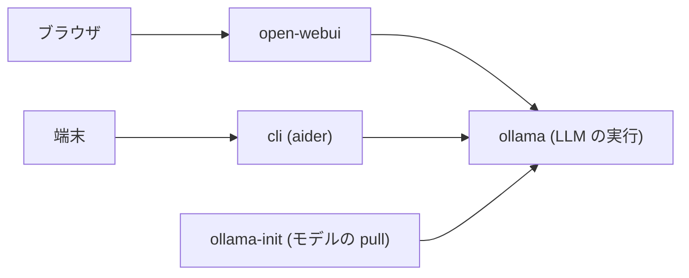

# local-ai-chat

手元のマシンで LLM を動かし、ブラウザのチャット画面 ([Open WebUI](https://github.com/open-webui/open-webui)) と、端末で動く AI コーディングアシスタント ([aider](https://aider.chat/)) から使う環境です。Claude Code や Codex が安全フィルターで断るタスク (セキュリティ研究・exploit の分析・センシティブな創作など) に使うため、拒否を減らしたモデルを中心に収録しています。



どれも Docker Compose のサービスです。`ollama` と `open-webui` は起動している間動き続け、`ollama-init` はモデルの pull を終えると止まり、`cli` は CLI のタスクを実行したときだけ動きます。操作は [mise](https://mise.jdx.dev/) のタスク (`mise run <task>`) で行います。

## 必要なもの

- Docker Compose v2 と mise
- モデルを置くディスク: 全モデルで約 360GB (Apple Silicon の構成では約 380GB)
- NVIDIA GPU を使う場合: NVIDIA Container Toolkit
- Apple Silicon の Mac で GPU を使う場合: macOS 14 以降と、Docker Desktop か OrbStack

使うモデルが載るメモリも要ります。モデルごとの目安は「[モデル](#モデル)」にあります。Docker Desktop で Ollama をコンテナで動かすときは、Docker Desktop の VM にそのメモリを割り当ててください (既定はホストの 50%)。

## 起動と停止

初回だけ、ツールを入れて git の hook を設定します。

```sh
mise trust && mise install
```

マシンに合わせて起動のタスクを選び、起動したら `mise run ui` で Web UI を開きます。止めるときは `mise run down` を実行します。

| マシン                             | 起動のタスク                                                                        |
| ---------------------------------- | ----------------------------------------------------------------------------------- |
| GPU を使わない                     | `mise run up`                                                                       |
| NVIDIA GPU のあるマシン            | `mise run up:gpu`                                                                   |
| Apple Silicon の Mac で GPU を使う | 「[Apple Silicon の Mac で GPU を使う](#apple-silicon-の-mac-で-gpu-を使う)」の手順 |

起動すると、`ollama/models.txt` に並べたモデルのダウンロード (pull) がバックグラウンドで始まります。ダウンロードしたモデルは、固定した版 (digest) と一致するかを確かめてから、`qwen35-4b-heretic` のような短い名前 (エイリアス) で登録され、Web UI と CLI から使えるようになります。進み具合は `mise run logs` で見られ、`ready: <alias>` と出たモデルが使える状態です。

### Apple Silicon の Mac で GPU を使う

macOS の Docker のコンテナからは GPU (Metal) を使えません。そのため、この構成では Ollama をコンテナではなくホストで動かし、コンテナの `ollama` サービスはホストの Ollama へ転送するだけになります。ホストの Ollama は、Ollama の library に MLX 形式の版しか無いモデル (`ollama/models.txt` で `mlx` を付けた行) も動かせます。

この構成の Compose ファイルは `!reset` タグを使うので、対応した Docker Compose が要ります。`docker compose -f compose.yaml -f compose.apple.yaml config --quiet` がエラーなく終われば対応しています。

1. ほかの構成で起動しているなら `mise run down` で止め、Ollama.app など、ほかの Ollama も止めます。ホストの Ollama は `OLLAMA_PORT` (既定 11434) で待ち受けるので、同じポートを使うものが動いていると起動できないか、そちらに接続してしまいます。
2. 1 つ目の端末で `mise run serve` を実行し、ホストの Ollama を起動します。`Listening on` と表示されたら起動済みで、この端末は開いたままにします。
3. 2 つ目の端末で `mise run up:apple` を実行します。

止めるときは `mise run down` を実行し、`mise run serve` の端末で Ctrl-C を押します。通常の構成に戻すときは、両方を止めてから `mise run up` で起動します。

ホストの Ollama は、`mise install` がコンテナのイメージと同じ版を入れたものです。モデルはコンテナのときと同じ `data/ollama/models` に置くので、構成を切り替えても pull し直す必要はありません。ollama.com の認証鍵は `data/ollama/home` に置き、ホストのユーザーのサインイン状態は使いません。Web UI と CLI の接続先は、通常の構成と変わりません。

この構成では、`BIND_HOST` に loopback を含むアドレス (`127.0.0.1`・`0.0.0.0`・`::1`・`::` など) だけを使えます。コンテナはホストの loopback を経由してホストの Ollama に接続するためです。

MLX 形式のモデルはこの構成でだけ pull されます。この構成で pull した後に通常の構成へ戻すと、そのモデルは選択肢に残りますが動かないので、使わないなら、`docker compose exec ollama ollama rm inkling2-mini inkling-2-mini:26b-a5b-nvfp4` のように、エイリアスと取得元の名前 (`ollama/models.txt` の 2 列目) を指定して消してください。

## 使い方

- **Web UI**: `mise run ui` で開きます (既定では http://localhost:3000)。チャット画面でモデルを選んで使います。
- **CLI (aider)**: `mise run code` は git と連携してリポジトリのコードを編集します (変更は自動で commit しません)。`mise run chat` は git 連携とリポジトリの全体像の把握 (repo map) を切った軽い会話用で、こちらもファイルを編集できます。どちらも既定ではこのリポジトリを開くので、ほかのプロジェクトは `MOUNT_DIR=/path/to/project mise run code` のように指定します。
- **CLI のモデルの切り替え**: `MODEL=goetia mise run chat` のように、その回だけ使うモデルのエイリアスを指定します。既定のモデルは「[設定](#設定)」の `DEFAULT_MODEL` で変えます。
- **API**: Ollama の API を http://localhost:11434 で使えます (OpenAI 互換の API は `/v1`)。

`chat`・`code`・`shell`・`pull`・`models` のタスクは、起動中のサービスと同じ構成で動きます。先に `up`・`up:gpu`・`up:apple` のどれかで起動しておいてください。

## 設定

ポート・bind 先・既定モデルなどの設定項目は、`mise.toml` の `[env]` に既定値と説明付きで並んでいます。手元で変えるときは、git 管理外の `mise.local.toml` を作って `[env]` に書きます。

```toml
# mise.local.toml
[env]
WEBUI_AUTH = "true" # Web UI にログイン画面を付ける
BIND_HOST = "0.0.0.0" # 同じネットワークのほかの端末からも使う
```

既定ではポートを `127.0.0.1` にだけ bind し、同じマシンからしか接続できません。`BIND_HOST` を `0.0.0.0` にすると、Web UI と Ollama の API の両方が同じネットワークのほかの端末に公開されます。

- Web UI は、`WEBUI_AUTH` を `true` にしてログインを必須にしてください。`false` のままだと、接続できる人が誰でも管理者として使えます。ユーザーを登録した後は `false` に戻せません。
- Web UI では最初に登録したアカウントが管理者になります。公開する前に、`BIND_HOST` を既定のまま起動して管理者を登録しておいてください。
- Ollama の API には認証がありません。接続できる人は誰でも、モデルの実行・追加・削除ができます。

既定のモデルは `DEFAULT_MODEL` で変えます。`ollama/models.txt` のエイリアスにタグを付けて、`qwen38:latest` のように書きます。Web UI はこの値を初回の起動時にだけ読み、以後は Web UI の管理画面の設定が優先されます。

mise は `[env]` の値をシェルの環境変数より優先し、値の中の `$` を変数として展開します (`$` そのものは `$$` と書きます)。`MODEL` や `MOUNT_DIR` のように実行のたびに変える値は、`[env]` に書かずにシェルから渡してください。

## モデル

主なモデルと用途は次のとおりです。既定のモデルは `qwen35-4b-heretic` です。選んだ根拠・モデルごとの詳細・ライセンスは [docs/models.md](docs/models.md) にあります。

| エイリアス           | 用途                                                            | サイズ | メモリの目安 (Apple Silicon / NVIDIA) |
| -------------------- | --------------------------------------------------------------- | ------ | ------------------------------------- |
| `qwen35-4b-heretic`  | 軽量・日常使い・画像入力                                        | ~3GB   | 8GB+ / 6GB+                           |
| `qwen35-9b-heretic`  | 推論・脅威分析・画像入力                                        | ~6GB   | 16GB+ / 8GB+                          |
| `gemma4-31b-heretic` | 汎用・セキュリティ・CTF・exploit                                | ~19GB  | 32GB+ / 24GB+                         |
| `qwen35-27b-heretic` | 医療・薬学・法律などの知識 (専門分野の正確性は未評価)・画像入力 | ~17GB  | 32GB+ / 24GB+                         |
| `goetia`             | 創作・ロールプレイ (NSFW を含む)                                | ~17GB  | 32GB+ / 24GB+                         |
| `qwen38`             | コーディング・エージェント                                      | ~19GB  | 32GB+ / 24GB+                         |
| `inkling2-mini`      | コーディング・画像入力 (Apple Silicon の構成だけ)               | ~20GB  | 32GB+ / —                             |
| `qwen38-cyber`       | ペンテスト・画像入力                                            | ~20GB  | 32GB+ / 24GB+                         |
| `ripple-abliterated` | ペンテスト (大型)                                               | ~39GB  | 64GB+ / 48GB+                         |
| `gemma4-26b-heretic` | 性能重視 (abliterated)・画像入力                                | ~18GB  | 32GB+ / 24GB+                         |
| `xortron-large`      | 性能重視 (abliterated、大型)                                    | ~73GB  | 128GB+ / 96GB+                        |
| `qwen35-queen`       | 性能重視 (uncensored)・画像入力                                 | ~17GB  | 32GB+ / 24GB+                         |
| `assistant-pepe`     | 性能重視 (uncensored、大型)                                     | ~43GB  | 64GB+ / 48GB+                         |
| `llama4`             | 1M トークンを超える長文・画像入力                               | ~67GB  | 96GB+ / 80GB+                         |

abliterated は拒否に関わる方向を重みから取り除いたモデル、uncensored は追加学習や merge で拒否を減らしたモデルです。サイズは Q4 量子化でのダウンロード量で、実行時はこれに KV cache の分のメモリが加わります。

モデルを足すときは、`ollama/models.txt` にエイリアスと取得元 (`hf.co/<user>/<repo>:<tag>` など) を並べた `<alias> <source>` の 1 行を足し、`mise run digests` で digest を書き込んでから `mise run pull` を実行します。書き方の決まりは [docs/models.md](docs/models.md#モデルを追加する) にあります。

## 開発

`mise install` が git の hook を設定し、commit のたびに整形・lint・secret の検査が走ります。検査の内容・CI・依存関係の更新の仕組みは [docs/development.md](docs/development.md) にあります。

## タスク一覧

`mise run <task>` で実行できるタスクです。`mise.toml` から自動で生成しています。

<!-- dprint-ignore-start -->
<!-- mise-tasks -->
## `chat`

- **Usage:** `chat`

aider でチャットする (環境変数 MODEL にエイリアスを指定するとモデルを切り替えられる)

## `code`

- **Usage:** `code`

MOUNT_DIR のコードを aider で編集する (環境変数 MODEL でモデルを切り替え、`--` 以降は aider に渡す)

## `digests`

- **Usage:** `digests`

ollama/models.txt の digest を各 tag が今指す manifest に更新する (digest の無い行には追記する)

## `docs`

- **Usage:** `docs`

README.md のタスク一覧を mise.toml と同期する

## `down`

- **Usage:** `down`

全サービスを停止する

## `logs`

- **Usage:** `logs`

ログを追従表示する

## `models`

- **Usage:** `models`

Ollama に登録済みのモデルを一覧する

## `pull`

- **Usage:** `pull`

ollama/models.txt のモデルを pull してエイリアスを更新する

## `serve`

- **Usage:** `serve`

Apple Silicon の構成で、ホストの Ollama を起動する (`mise run up:apple` の前に別のターミナルで実行し、Ctrl-C で止める)

## `shell`

- **Usage:** `shell`

aider コンテナで bash を起動する

## `template-diff`

- **Usage:** `template-diff`

共通ファイルを dope-corp/template の main と比較する

## `ui`

- **Usage:** `ui`

Web UI をブラウザで開く

## `up`

- **Usage:** `up`

全サービスを起動する。モデルの pull はバックグラウンドで進む (`mise run logs` で確認)

## `up:apple`

- **Usage:** `up:apple`

Apple Silicon の構成で全サービスを起動する (先に別のターミナルで `mise run serve` を実行しておく)

## `up:gpu`

- **Usage:** `up:gpu`

NVIDIA GPU を ollama に割り当てて全サービスを起動する
<!-- /mise-tasks -->
<!-- dprint-ignore-end -->
