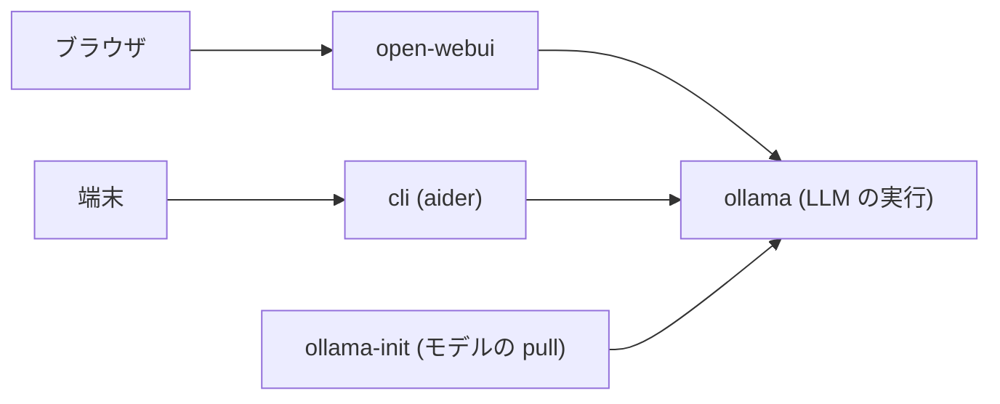
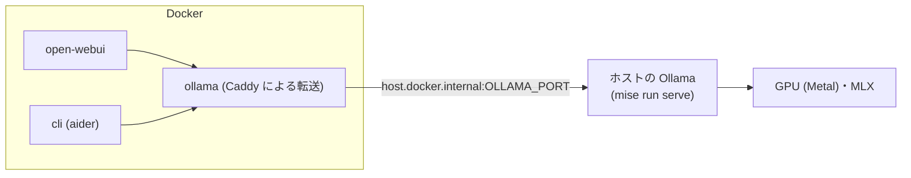

# local-ai-chat

手元のマシンで LLM を動かし、ブラウザのチャット画面 ([Open WebUI](https://github.com/open-webui/open-webui)) と、端末で動く AI コーディングアシスタント ([aider](https://aider.chat/)) から使う環境です。Claude Code や Codex が安全フィルターで断るタスク (セキュリティ研究・exploit の分析・センシティブな創作など) に使うため、拒否を減らしたモデルを中心に収録しています。



どれも Docker Compose のサービスで、操作は [mise](https://mise.jdx.dev/) のタスク (`mise run <task>`) で行います。

| サービス      | 動いている期間                                                          |
| ------------- | ----------------------------------------------------------------------- |
| `ollama`      | 起動から停止まで                                                        |
| `open-webui`  | 起動から停止まで                                                        |
| `ollama-init` | 起動時と `mise run pull` の実行時に動き、モデルの pull を終えると止まる |
| `cli`         | `mise run code` の実行中だけ                                            |

## 必要なもの

| 対象                               | 必要なもの                                                                                                                                                                                 |
| ---------------------------------- | ------------------------------------------------------------------------------------------------------------------------------------------------------------------------------------------ |
| すべて                             | Docker Compose v2、mise                                                                                                                                                                    |
| モデルを置くディスク               | 全モデルで約 360GB (Apple Silicon の構成では約 380GB)                                                                                                                                      |
| NVIDIA GPU を使う                  | NVIDIA Container Toolkit                                                                                                                                                                   |
| Apple Silicon の Mac で GPU を使う | macOS 14 以降、Docker Desktop か OrbStack、`!reset` タグに対応した Docker Compose (`docker compose -f compose.yaml -f compose.apple.yaml config --quiet` がエラーなく終われば対応している) |

使うモデルが載るメモリも要ります。モデルごとの目安は「[モデル一覧](docs/models.md#モデル一覧)」にあります。Docker Desktop で Ollama をコンテナで動かすときは、Docker Desktop の VM にそのメモリを割り当ててください (既定はホストの 50%)。

## 起動と停止

初回だけ、ツールを入れて git の hook を設定します。

```sh
mise trust && mise install
```

マシンに合わせて起動します。

| マシン                             | 起動                                                                                | 停止            |
| ---------------------------------- | ----------------------------------------------------------------------------------- | --------------- |
| GPU を使わない                     | `mise run up`                                                                       | `mise run down` |
| NVIDIA GPU のあるマシン            | `mise run up:gpu`                                                                   | `mise run down` |
| Apple Silicon の Mac で GPU を使う | 「[Apple Silicon の Mac で GPU を使う](#apple-silicon-の-mac-で-gpu-を使う)」の手順 | 同じ節の手順    |

起動すると、`ollama/models.txt` のモデルの pull がバックグラウンドで始まります。pull したモデルは、固定した版 (digest) と一致したものだけが `qwen35-4b-heretic` のような短い名前 (エイリアス) で登録されます (「[digest の照合](docs/models.md#digest-の照合)」)。進み具合は `mise run logs` で見られ、`ready: <alias>` と出たモデルから使えます。

起動したら、次のものから使います。各タスクの詳細は「[タスク一覧](#タスク一覧)」にあります。

| 使うもの | 入口                                       | 既定の接続先                                        |
| -------- | ------------------------------------------ | --------------------------------------------------- |
| Web UI   | `mise run ui`                              | http://localhost:3000                               |
| aider    | `mise run code` (端末からコードを編集する) | —                                                   |
| API      | Ollama の API                              | http://localhost:11434 (OpenAI 互換の API は `/v1`) |

### Apple Silicon の Mac で GPU を使う

macOS の Docker のコンテナからは GPU (Metal) を使えません。そのため、この構成では Ollama をホストで動かし、コンテナの `ollama` サービスはホストの Ollama へ転送するだけになります。Web UI と CLI の接続先は、通常の構成と変わりません。



| 項目                 | 通常の構成           | この構成                                                                                                               |
| -------------------- | -------------------- | ---------------------------------------------------------------------------------------------------------------------- |
| Ollama の版          | コンテナのイメージ   | `mise install` が入れた、イメージと同じ版                                                                              |
| モデルの置き場       | `data/ollama/models` | 同じ (構成を切り替えても pull し直さない)                                                                              |
| ollama.com の認証鍵  | `data/ollama`        | `data/ollama/home` (ホストのユーザーのサインイン状態は使わない)                                                        |
| `mlx` を付けたモデル | pull しない          | pull する (Ollama の library に MLX 形式しか無いモデル)                                                                |
| `BIND_HOST`          | 任意                 | loopback を含むアドレスだけ (`127.0.0.1`・`0.0.0.0`・`::1`・`::` など)。コンテナがホストの loopback 経由で接続するため |

| 手順 | 端末   | 操作                                                                                                                                                                                        |
| ---- | ------ | ------------------------------------------------------------------------------------------------------------------------------------------------------------------------------------------- |
| 1    | どれか | ほかの構成で起動していれば `mise run down` で止める。Ollama.app などのほかの Ollama も止める。`OLLAMA_PORT` (既定 11434) を使うものが動いていると、起動に失敗するか、そちらに接続してしまう |
| 2    | 1 つ目 | `mise run serve` でホストの Ollama を起動する。`Listening on` と出たら起動済みで、この端末は開いたままにする                                                                                |
| 3    | 2 つ目 | `mise run up:apple` を実行する                                                                                                                                                              |
| 停止 | 両方   | `mise run down` を実行し、`mise run serve` の端末で Ctrl-C を押す。通常の構成に戻すときは、両方を止めてから `mise run up` で起動する                                                        |

この構成で pull した MLX 形式のモデルは、通常の構成に戻すと選択肢に残りますが動きません。使わないなら、`docker compose exec ollama ollama rm inkling2-mini inkling-2-mini:26b-a5b-nvfp4` のように、エイリアスと取得元の名前 (`ollama/models.txt` の 2 列目) を指定して消してください。

## 設定

ポート・bind 先・既定モデルなどの設定項目は、`mise.toml` の `[env]` に既定値と説明付きで並んでいます。手元で変えるときは、git 管理外の `mise.local.toml` を作って `[env]` に書きます。mise から動かす Compose は `.env` を読みません。

```toml
# mise.local.toml
[env]
WEBUI_AUTH = "true" # Web UI にログイン画面を付ける
BIND_HOST = "0.0.0.0" # 同じネットワークのほかの端末からも使う
```

| `BIND_HOST`        | 接続できる範囲                                                  |
| ------------------ | --------------------------------------------------------------- |
| `127.0.0.1` (既定) | 同じマシンだけ                                                  |
| `0.0.0.0`          | 同じネットワークのほかの端末も (Web UI と Ollama の API の両方) |

公開するときは、次の点に注意してください。

| 対象          | 注意点                                                                                                                                                   |
| ------------- | -------------------------------------------------------------------------------------------------------------------------------------------------------- |
| Web UI        | `WEBUI_AUTH` を `true` にしてログインを必須にする。`false` のままだと、接続できる人が誰でも管理者として使える。ユーザーを登録した後は `false` に戻せない |
| Web UI        | 最初に登録したアカウントが管理者になる。公開する前に、`BIND_HOST` を既定のまま起動して管理者を登録しておく                                               |
| Ollama の API | 認証が無い。接続できる人は誰でも、モデルの実行・追加・削除ができる                                                                                       |

既定のモデルは `DEFAULT_MODEL` で変えます。`ollama/models.txt` のエイリアスにタグを付けて、`qwen38:latest` のように書きます。Web UI はこの値を初回の起動時にだけ読み、以後は Web UI の管理画面の設定が優先されます。

mise は `[env]` の値をシェルの環境変数より優先し、値の中の `$` を変数として展開します (`$` そのものは `$$` と書きます)。`MODEL` や `MOUNT_DIR` のように実行のたびに変える値は、`[env]` に書かずにシェルから渡してください。

## モデル

既定のモデルは軽量な `qwen35-4b-heretic` です。ほかに、セキュリティ・CTF・創作・コーディング・ペンテスト・長文などの用途ごとに選んだモデルを収録しています。モデルの一覧 (用途・サイズ・メモリの目安)・選んだ根拠・ライセンスは [docs/models.md](docs/models.md) にあります。

モデルを足す手順は「[モデルを追加する](docs/models.md#モデルを追加する)」にあります。

## 開発

`mise install` が git の hook を設定し、commit のたびに整形・lint・secret の検査が走ります。検査の内容・CI・依存関係の更新の仕組みは [docs/development.md](docs/development.md) にあります。

## タスク一覧

`mise run <task>` で実行できるタスクです。`mise.toml` から自動で生成しています。

<!-- dprint-ignore-start -->
<!-- mise-tasks -->
## `code`

aider でコードを編集する。aider は git と連携するが、変更を自動では commit しない。

既定ではこのリポジトリを開く。ほかのディレクトリは `MOUNT_DIR=/path/to/project mise run code` のように指定する (相対パスはこのリポジトリの直下が基準)。モデルは `MODEL=goetia mise run code` のように ollama/models.txt のエイリアスで指定し、省略すると設定の `DEFAULT_MODEL` を使う。`--` 以降の引数は aider に渡す (例: `mise run code -- --no-git`)。

先に `up`・`up:gpu`・`up:apple` のどれかでサービスを起動しておく。起動中の構成で動く。


- **Usage:** `code`

## `digests`

ollama/models.txt の digest を各 tag が今指す manifest に更新する (digest の無い行には追記する)。

モデルを追加・変更したときに使う。手順は docs/models.md の「モデルを追加する」にある。既存のモデルの digest は Renovate が更新する。


- **Usage:** `digests`

## `docs`

- **Usage:** `docs`

README.md のタスク一覧を mise.toml と同期する

## `down`

- **Usage:** `down`

全サービスを停止する

## `logs`

- **Usage:** `logs`

ログを追従表示する

## `models`

Ollama に登録済みのモデルを一覧する。

先に `up`・`up:gpu`・`up:apple` のどれかでサービスを起動しておく。起動中の構成で動く。


- **Usage:** `models`

## `pull`

ollama/models.txt のモデルを pull してエイリアスを更新する。

サービスの起動時にも同じ処理が走る。起動したまま models.txt に追加・変更したモデルを取り込むときに使う (行を消したモデルは Ollama から消えない)。先に `up`・`up:gpu`・`up:apple` のどれかでサービスを起動しておく。起動中の構成で動く。


- **Usage:** `pull`

## `serve`

- **Usage:** `serve`

Apple Silicon の構成で、ホストの Ollama を起動する (`mise run up:apple` の前に別の端末で実行し、Ctrl-C で止める)

## `ui`

- **Usage:** `ui`

Web UI をブラウザで開く

## `up`

- **Usage:** `up`

GPU を使わずにサービスを起動する

## `up:apple`

Apple Silicon の Mac で、GPU を使えるホストの Ollama に接続してサービスを起動する。

先に別の端末で `mise run serve` を実行しておく。手順と制約は README の「Apple Silicon の Mac で GPU を使う」にある。


- **Usage:** `up:apple`

## `up:gpu`

- **Usage:** `up:gpu`

NVIDIA GPU を ollama に割り当ててサービスを起動する
<!-- /mise-tasks -->
<!-- dprint-ignore-end -->
