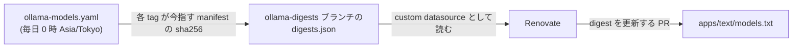

# 開発

## commit 時の検査

`mise install` が [prek](https://github.com/j178/prek) で git の hook を設定し、commit のたびに `.pre-commit-config.yaml` の検査を走らせます。

| 対象                       | 検査                                                                                    |
| -------------------------- | --------------------------------------------------------------------------------------- |
| すべてのファイル           | 行末の空白・末尾の改行・改行コードの混在・conflict marker・新しく追加する大きなファイル |
| JSON・YAML・TOML・Markdown | 構文 (Markdown を除く) と、dprint による整形                                            |
| シェルスクリプト           | shellcheck                                                                              |
| GitHub Actions の workflow | actionlint・zizmor                                                                      |
| compose ファイル           | `docker compose config` (GPU と Apple Silicon の構成もそれぞれ重ねて検査する)           |
| Ollama の版                | `apps/text/compose.yaml` のイメージと `mise.toml` のホスト用の版が一致するか            |
| 綴り                       | typos                                                                                   |
| README のタスク一覧        | `mise.toml` を変えたときに `mise run docs` で再生成する                                 |
| staged の差分              | gitleaks による secret の検出                                                           |
| commit message             | commitlint による [Conventional Commits](https://www.conventionalcommits.org/) の検査   |

compose ファイルの検査には、`compose.apple.yaml` (`apps/text/`・`apps/image/`) の `!reset` タグに対応した Docker Compose が要ります。

全ファイルを検査するには `mise exec -- prek run --all-files` を実行します。commit message の検査は含まれません。整形とタスク一覧の再生成は、ファイルを書き換えることがあります。

## CI と GitHub Actions

| workflow             | 動く契機                 | 内容                                                                                                                          |
| -------------------- | ------------------------ | ----------------------------------------------------------------------------------------------------------------------------- |
| `ci.yaml`            | pull request             | `prek` job が全ファイルに上の検査 (commit message の検査を除く) をかけ、`gitleaks` job が commit の履歴全体から secret を探す |
| `claude.yaml`        | issue・PR での `@claude` | OWNER か MEMBER のメンションに Claude Code が応答する                                                                         |
| `claude-sweep.yaml`  | 毎週月曜                 | 前回成功した回以降の差分を Claude Code がレビューし、指摘を issue に起票する。初回と、差分が無い回はレビューしない            |
| `ollama-models.yaml` | 毎日 0 時 (Asia/Tokyo)   | モデルの digest を計算する (「[依存関係の更新](#依存関係の更新)」)                                                            |

Claude Code の workflow には、リポジトリの secret `CLAUDE_CODE_OAUTH_TOKEN` (`claude setup-token` で発行) が要ります。`@claude` への応答には、[Claude GitHub App](https://github.com/apps/claude) のインストールも要ります。

## 依存関係の更新

ツール・イメージ・モデルは、digest か exact version で固定しています (ComfyUI の Python の依存は除く。「[ComfyUI と画像・動画のモデル](#comfyui-と画像動画のモデル)」を参照)。Renovate は、毎週月曜 9 時前 (Asia/Tokyo) の時間帯に、次のものに更新があれば PR を作ります。

| 更新するもの                                                                                 | 固定の形                 |
| -------------------------------------------------------------------------------------------- | ------------------------ |
| `mise.toml` のツールと `mise.lock`                                                           | exact version            |
| compose ファイル (各アプリの `compose*.yaml`・`apps/shared/comfyui/compose.yaml`) のイメージ | `<tag>@sha256:<digest>`  |
| `apps/shared/comfyui/Dockerfile` のベースイメージ                                            | `<tag>@sha256:<digest>`  |
| `apps/shared/comfyui/compose.yaml` の `COMFYUI_VERSION`                                      | GitHub の release の tag |
| workflow の `uses:`                                                                          | commit SHA               |
| `.pre-commit-config.yaml` の hook                                                            | tag                      |
| `.dprint.json` の plugin                                                                     | version と sha256        |
| `apps/text/models.txt` のモデル                                                              | manifest の digest       |

### merge の扱い

| 更新の種類                                        | PR                   | merge                   |
| ------------------------------------------------- | -------------------- | ----------------------- |
| major 以外 (minor・patch・pin・digest・pinDigest) | 1 つの PR にまとめる | GitHub の auto-merge    |
| `mise.lock` の再生成 (lock file maintenance)      | 別の PR              | GitHub の auto-merge    |
| major                                             | 個別の PR            | 手で確認して merge する |

auto-merge は、main の ruleset が必須にしている CI の `prek` と `gitleaks` が通るまで待ちます。

Renovate は、公開から 7 日経っていない版を待ってから取り込みます (`minimumReleaseAge`)。公開日時を取得できない次のものは、待たずに取り込みます。

- ghcr.io のイメージ
- tag が付け替えられた action の digest
- モデルの digest
- `mise.lock` の再生成

### モデルの digest

Ollama 形式のレジストリは manifest の digest を返さないので、Renovate はモデルの digest を自分で求められません。代わりに次の流れで更新します。

モデルを追加してから最初の計算までは、Renovate の Dependency Dashboard に digest を決められないという警告が出ます。

### Ollama の版

Ollama は次の 2 か所で固定しており、同じ版にそろえます。片方だけを更新する PR は、もう片方を追従させてから merge します。食い違いは `apps/text/check-versions.sh` が commit 時と CI で検出します。

| 場所                                | 使うもの                                                       |
| ----------------------------------- | -------------------------------------------------------------- |
| `apps/text/compose.yaml` のイメージ | `ollama-init` と、Apple Silicon の構成以外の `ollama` サービス |
| `mise.toml` の `ollama`             | Apple Silicon の構成でホストに動かす Ollama                    |

### ComfyUI と画像・動画のモデル

ComfyUI の版は `apps/shared/comfyui/compose.yaml` の `COMFYUI_VERSION` の 1 か所で固定し、NVIDIA の構成のイメージ (`apps/shared/comfyui/Dockerfile`) と Apple Silicon の構成のホストへの導入 (`apps/shared/comfyui/serve.sh`) の両方がこの値を使います。ComfyUI の Python の依存 (PyTorch を含む) は固定しておらず、イメージを build したときと、ホストに入れたときの最新の版が入ります。

`apps/image/models.txt`・`apps/video/models.txt` の commit と sha256 は Renovate では更新されません。モデルを更新するときは、「[画像・動画のモデルを追加する](models.md#画像動画のモデルを追加する)」の手順で行を書き換えます。
