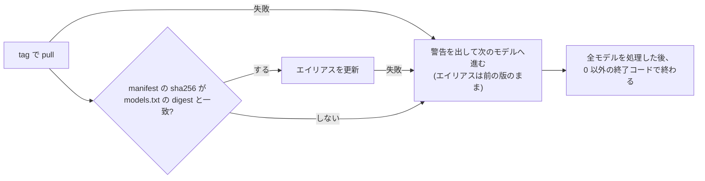

# 収録モデル

このリポジトリが起動時に pull するモデルの一覧、各モデルの詳細、選んだ根拠、モデルの追加方法をまとめます。どのモデルも `ollama/models.txt` に書かれたものです。

## 用語

| 用語        | 意味                                                                                                                                                                                                                                                |
| ----------- | --------------------------------------------------------------------------------------------------------------------------------------------------------------------------------------------------------------------------------------------------- |
| abliterated | 拒否に関わる方向を重みから取り除いたモデル。Heretic・Derestricted などのツールで処理する。配布元のモデルカードかタグに abliteration (Heretic・Derestricted を含む) で処理したとあれば、`uncensored` のタグが併記されていても abliterated に分類する |
| uncensored  | 追加学習や merge で拒否を減らしたモデル                                                                                                                                                                                                             |
| Heretic     | abliteration のツール。エイリアスの `heretic` は、このツールで処理したモデルを指す                                                                                                                                                                  |
| thinking    | 応答の前に推論を書き出すモード。Qwen3.5 系と Gemma 4 系は、Ollama で `think` を指定しないと有効になり、`think: false` で無効にできる                                                                                                                |

## モデル一覧

| エイリアス           | ベースモデル                     | 構成                                | コンテキスト | サイズ | 用途                                                            | メモリの目安                        |
| -------------------- | -------------------------------- | ----------------------------------- | ------------ | ------ | --------------------------------------------------------------- | ----------------------------------- |
| `qwen35-4b-heretic`  | Alibaba Qwen3.5 4B               | Dense 4B                            | 256K         | ~3GB   | 軽量汎用・デイリーユース・画像入力                              | Apple Silicon 8GB+ / NVIDIA 6GB+    |
| `qwen35-9b-heretic`  | Alibaba Qwen3.5 9B               | Dense 9B                            | 256K         | ~6GB   | 推論・脅威分析・ロジック問題・画像入力                          | Apple Silicon 16GB+ / NVIDIA 8GB+   |
| `gemma4-31b-heretic` | Google Gemma 4 31B               | Dense 31B                           | 256K         | ~19GB  | 汎用・セキュリティ・CTF・exploit                                | Apple Silicon 32GB+ / NVIDIA 24GB+  |
| `qwen35-27b-heretic` | Alibaba Qwen3.5 27B              | Dense 27B                           | 256K         | ~17GB  | 医療・薬学・法律などの専門知識・画像入力                        | Apple Silicon 32GB+ / NVIDIA 24GB+  |
| `goetia`             | Google Gemma 4 26B-A4B の merge  | MoE (総26B / 実効4B)                | 256K         | ~17GB  | 創作・フィクション・ロールプレイ (NSFW を含む)                  | Apple Silicon 32GB+ / NVIDIA 24GB+  |
| `qwen38`             | Alibaba Qwen3.8 27B              | Dense 27B                           | 256K         | ~19GB  | コーディング・エージェント                                      | Apple Silicon 32GB+ / NVIDIA 24GB+  |
| `inkling2-mini`      | Thinking Machines Inkling 2 Mini | MoE (総26B / 実効5.4B)              | 1M           | ~20GB  | コーディング・エージェント・画像入力 (Apple Silicon の構成だけ) | Apple Silicon 32GB+                 |
| `qwen38-cyber`       | Alibaba Qwen3.8 27B              | Dense 27B                           | 256K         | ~20GB  | ペンテスト (36B 以下)・画像入力                                 | Apple Silicon 32GB+ / NVIDIA 24GB+  |
| `ripple-abliterated` | Ricursive Ripple 65B Preview     | Dense 65B                           | 1M           | ~39GB  | ペンテスト (125B 以下)                                          | Apple Silicon 64GB+ / NVIDIA 48GB+  |
| `gemma4-26b-heretic` | Google Gemma 4 26B-A4B           | MoE (総26B / 実効4B)                | 256K         | ~18GB  | 最も性能の高い abliterated (36B 以下)・画像入力                 | Apple Silicon 32GB+ / NVIDIA 24GB+  |
| `xortron-large`      | Mistral Large 2411 123B          | Dense 123B                          | 128K         | ~73GB  | 最も性能の高い abliterated (36B 超〜125B)                       | Apple Silicon 128GB+ / NVIDIA 96GB+ |
| `qwen35-queen`       | Alibaba Qwen3.5 27B              | Dense 27B                           | 256K         | ~17GB  | 最も性能の高い uncensored (36B 以下)・画像入力                  | Apple Silicon 32GB+ / NVIDIA 24GB+  |
| `assistant-pepe`     | Meta Llama 3.1 70B               | Dense 70B                           | 128K         | ~43GB  | 最も性能の高い uncensored (36B 超〜125B)                        | Apple Silicon 64GB+ / NVIDIA 48GB+  |
| `llama4`             | Meta Llama 4 Scout               | MoE (総109B / 実効17B / 16 experts) | 10M          | ~67GB  | 1M トークンを超える長文・画像入力                               | Apple Silicon 96GB+ / NVIDIA 80GB+  |

| 項目         | 説明                                                                                                                                                                                                                                                                 |
| ------------ | -------------------------------------------------------------------------------------------------------------------------------------------------------------------------------------------------------------------------------------------------------------------- |
| 構成         | MoE の「総」は全パラメータ数、「実効」は 1 トークンの生成で使うパラメータ数                                                                                                                                                                                          |
| コンテキスト | 公称の上限のトークン数                                                                                                                                                                                                                                               |
| サイズ       | Q4 量子化でのダウンロード量で、画像入力用の projector を含む。全モデルで約 360GB、Apple Silicon の構成では `mlx` を付けたモデルの分が加わって約 380GB                                                                                                                |
| メモリの目安 | Apple Silicon はホストの搭載メモリ、NVIDIA は GPU の VRAM の目安。実行時はサイズに KV cache の分が加わる。Ollama をコンテナで動かす構成 (Apple Silicon の構成以外) では、Docker Desktop の VM にもそれだけのメモリを割り当てる (Docker Desktop の既定はホストの 50%) |
| pull の順序  | `ollama/models.txt` の上から順。既定のモデル `qwen35-4b-heretic` を先頭に置いている                                                                                                                                                                                  |
| エイリアス   | Ollama には `<alias>:latest` の名前で登録される                                                                                                                                                                                                                      |

## モデルごとの詳細

選んだ理由にある指標 (UGI・NatInt など) は、「[選定基準](#選定基準)」で説明します。

| エイリアス           | 処理                                         | 選んだ理由                                                                     | 画像入力                          | ライセンス                                                                      |
| -------------------- | -------------------------------------------- | ------------------------------------------------------------------------------ | --------------------------------- | ------------------------------------------------------------------------------- |
| `qwen35-4b-heretic`  | Heretic で abliteration                      | 10B 以下で UGI が 1 位                                                         | 対応                              | Apache 2.0                                                                      |
| `qwen35-9b-heretic`  | Heretic で abliteration                      | 10B 以下で NatInt が 1 位                                                      | 対応                              | Apache 2.0                                                                      |
| `gemma4-31b-heretic` | coder3101 が Heretic で abliteration         | 36B 以下で UGI が 1 位 (65.69)                                                 | 非対応 (GGUF に projector が無い) | Apache 2.0                                                                      |
| `qwen35-27b-heretic` | Heretic で abliteration                      | 36B 以下で Textbook が 1 位                                                    | 対応                              | Apache 2.0                                                                      |
| `goetia`             | Naphula が merge し、Heretic で abliteration | 36B 以下で Writing が 1 位 (47.87)                                             | 非対応 (GGUF に projector が無い) | Apache 2.0                                                                      |
| `qwen38`             | HauhauCS が拒否を減らした (手法の記載なし)   | ベースが公式の値で前世代を上回る                                               | projector も pull されるが未検証  | Apache 2.0                                                                      |
| `inkling2-mini`      | なし (公式モデル)                            | Apple Silicon の構成のコーディング枠                                           | 対応                              | Apache 2.0                                                                      |
| `qwen38-cyber`       | philbert440 が abliteration                  | ベースの Terminal-Bench 2.1 が 36B 以下で 1 位 (73.0)                          | 対応                              | Apache 2.0                                                                      |
| `ripple-abliterated` | 0xKitkat が abliteration                     | ベースの Terminal-Bench 2.1 が、公式の値がある収録モデルのベースで 1 位 (80.5) | 非対応                            | Apache 2.0                                                                      |
| `gemma4-26b-heretic` | llmfan46 が Heretic で abliteration          | 36B 以下の abliterated で NatInt が 1 位 (37.3)                                | 対応                              | Apache 2.0                                                                      |
| `xortron-large`      | darkc0de が Heretic で abliteration          | 36B 超〜125B で NatInt と UGI がともに 1 位 (UGI 66.16)                        | 非対応                            | 配布元は WTFPL と表記 (派生元の Mistral Large 2411 は Mistral Research License) |
| `qwen35-queen`       | aifeifei798 が追加学習                       | 36B 以下の uncensored で NatInt が 1 位                                        | 対応                              | Apache 2.0                                                                      |
| `assistant-pepe`     | SicariusSicariiStuff が追加学習              | 125B 以下の uncensored で NatInt が 1 位                                       | 非対応                            | Llama 3.1 Community License                                                     |
| `llama4`             | なし (Meta 公式)                             | 公称 10M トークンのコンテキストを持つ                                          | 対応                              | Llama 4 Community License                                                       |

各モデルの取得元 (Ollama の tag) は [`ollama/models.txt`](../ollama/models.txt) の 2 列目にあります。

### `gemma4-31b-heretic`

ベースは `google/gemma-4-31B-it` です。もう 1 つの指標の Hazardous では、同じ Gemma 4 31B を llmfan46 が処理した版が 1 位 (8.2) で、このモデルは 7.6 です。

### `qwen35-27b-heretic`

UGI Leaderboard 上の名前は `llmfan46/Qwen3.5-27B-heretic-v3` です。

### `goetia`

Gemma 4 26B-A4B 系の創作向けモデル (StyleTune・Pantheon など) を mergekit で合成しています。

### `qwen38`

Qwen3.8 27B をベースにした "Aggressive" 版で、配布元は、拒否率を最小化して直接的に回答すると説明しています。

| 項目             | Qwen3.8-27B (ベース、公式の値) | Qwen3.6-27B (前世代) |
| ---------------- | ------------------------------ | -------------------- |
| SWE-bench Pro    | 61.7                           | 53.5                 |
| LiveCodeBench v6 | 90.3                           | 83.9                 |

- 量子化: imatrix を使う独自の Q4_K_P (18GB) で、同じサイズの標準の量子化より品質の劣化が小さくなります。
- GGUF には multi-token prediction (MTP) 用のヘッドも入っています。
- 注意: Hugging Face の Ollama 互換のエンドポイントは K_P を量子化名として認識しないので、tag には GGUF のファイル名を指定しています。MTP のヘッドも非標準で、Ollama の版によっては読み込みに失敗します。そのときは、同世代の abliterated 版 `huihui_ai/Qwen3.8-abliterated:27b` (18GB) への差し替えを検討します。

### `inkling2-mini`

Thinking Machines の公式モデルで、拒否を減らす処理はしていません。Ollama の library には MLX 形式の tag しか無く、Ollama 0.40.17 はこのモデルを Apple Silicon の構成でしか実行できないので、その構成でだけ pull します (Hugging Face には GGUF もあります)。thinking は既定で有効で、Ollama の `think` で切り替えます。

| 指標 (公式の比較)  | `inkling2-mini` | Qwen3.8-27B (`qwen38` のベース) |
| ------------------ | --------------- | ------------------------------- |
| Terminal-Bench 2.1 | 71.6            | 73.0                            |
| DeepSWE 1.1        | 48.2            | 42.2                            |

### `qwen38-cyber`

`Qwen/Qwen3.8-27B` を、攻撃的なセキュリティの質問に答えるよう abliteration したモデルです。配布元の評価では、攻撃的なサイバー系のプロンプト 100 件のすべてに回答しています。thinking は GGUF の chat template の既定で有効です。

### `ripple-abliterated`

agentic coding 向けの Dense 65B モデル `ricursiveAI/Ripple-65B-Preview` を abliteration したモデルです。

- 配布元の評価: 有害なプロンプト 48 件のうち拒否は 1 件。推論・コード・ツール呼び出しの小規模な機能テストでは元のモデルとほぼ差が無く、エージェントとしての評価はしていない。
- 同じ Ripple を abliteration した dealignai 版は MMLU が 4.4 ポイント下がると計測されているので、低下を示す計測の無いこちらを選びました。
- 応答の前に `<think>` で推論を書くモデルで、chat template に thinking の切り替えはありません。
- 公称のコンテキスト長は 1M トークンです (GGUF のメタデータの値は 2M)。長いコンテキストの指定方法は [`llama4`](#llama4) と同じです。
- 注意: 独自の `ricursive` アーキテクチャで、Ollama 0.40.16 以降が必要です。

### `gemma4-26b-heretic`

ベースは `google/gemma-4-26B-A4B-it` です。

### `xortron-large`

ベースは `mistralai/Mistral-Large-Instruct-2411` です。UGI の 66.16 は収録モデルの中でも最も高い値です。Dense 123B なので、同じメモリに載る MoE より生成が遅くなります。

### `qwen35-queen`

`Qwen/Qwen3.5-27B` を追加学習したモデルで、abliteration ではなく学習で拒否を減らしています。配布元は、ロールプレイと複数の persona を演じることを特徴に挙げています。

### `assistant-pepe`

`meta-llama/Llama-3.1-70B-Instruct` を 4chan のデータで追加学習したモデルです。システムプロンプトが無くても使えるように学習されています。

### `llama4`

Ollama は、リクエストで `num_ctx` を指定しないと、VRAM の量に応じて 4,096・32,768・262,144 トークンのどれかのコンテキストで動かします。それより長い入力を扱うには、次のどれかでコンテキスト長を指定します。実際に扱える長さは、KV cache が収まるメモリの量で決まります。

| 使う経路                    | コンテキスト長の指定                                                              |
| --------------------------- | --------------------------------------------------------------------------------- |
| Ollama の API (`/api/chat`) | `options.num_ctx`                                                                 |
| Web UI                      | チャットの詳細設定のコンテキスト長                                                |
| OpenAI 互換の API (`/v1`)   | 指定を受け付けないので、`PARAMETER num_ctx` を書いた Modelfile で別のモデルを作る |

## 選定基準

用途ごとに、想定するマシンに載るサイズの中で、決めた指標が最も高いモデルを選びます。サイズは総パラメータ数で判定し、MoE も実効パラメータ数ではなく総数を使います。モデルを入れ替えるときも、この基準で比べ直します。

### 指標

多くの用途は、uncensored モデルを比べるベンチマーク [UGI Leaderboard](https://huggingface.co/spaces/DontPlanToEnd/UGI-Leaderboard) の次の指標で選びます。順位は 2026-10-17 更新のデータ ([ugi-leaderboard-data.csv](https://huggingface.co/spaces/DontPlanToEnd/UGI-Leaderboard/blob/91957a6e66771c651b0c9e472f415cf078091c06/ugi-leaderboard-data.csv)) によるもので、データが更新されると変わりえます。

| 指標      | 測るもの                                                          |
| --------- | ----------------------------------------------------------------- |
| W/10      | 拒否せずに答える度合い                                            |
| UGI       | センシティブな話題の知識と、議論の分かれる指示に従う度合いの総合  |
| Hazardous | LLM が通常は手伝わない話題の知識                                  |
| Textbook  | 事実・統計・数学・論理の一般知識 (専門分野の正確性は測っていない) |
| Writing   | 文章を書く力                                                      |
| NatInt    | 一般的な知識と知能の総合                                          |

UGI Leaderboard はコーディング・端末での作業・画像入力を測っていないので、それらは別の根拠で選びます。

### 用途ごとの指標

| 用途                                              | 比べる指標                                         | サイズの上限 |
| ------------------------------------------------- | -------------------------------------------------- | ------------ |
| 汎用・セキュリティ                                | UGI と Hazardous                                   | 36B          |
| 医療・薬学・法律などの専門知識                    | Textbook                                           | 36B          |
| 創作・ロールプレイ                                | Writing                                            | 36B          |
| 推論                                              | NatInt                                             | 10B          |
| 軽量・デイリーユース                              | UGI                                                | 10B          |
| 最も性能の高い abliterated                        | NatInt                                             | 36B / 125B   |
| 最も性能の高い uncensored                         | NatInt                                             | 36B / 125B   |
| コーディング・エージェント                        | Terminal-Bench 2.1・SWE-bench Pro (各社の公式値)   | 36B          |
| コーディング・エージェント (Apple Silicon の構成) | Terminal-Bench 2.1 (各社の公式値)                  | 36B          |
| ペンテスト                                        | ベースモデルの Terminal-Bench 2.1 (配布元の公式値) | 36B / 125B   |
| 1M トークンを超える長文                           | なし (公称のコンテキスト長で選ぶ)                  | —            |

上限が「36B / 125B」の用途は、36B 以下と 125B 以下で 1 つずつ選びます。

### UGI Leaderboard の指標で選ぶときの規則

- W/10 が 8 未満 (拒否が多い) のモデルは候補から外します。
- 総パラメータ数は、CSV の `Total Parameters` の値を使います。
- UGI Leaderboard は 1 つのモデルを thinking の有無で別の行として計測しているので、Ollama で既定のまま使ったときの状態に合う行で比べます。Ollama 0.40.17 は、`think` を指定しない要求でも、thinking に対応した GGUF の chat template では thinking を有効にします。そのため、Qwen3.5 系と Gemma 4 系は thinking 有りの行を使います。行が分かれていないモデルは、その 1 行を使います。
- 1 位が同点のときと、汎用のように 2 つの指標を使う用途で 1 位が分かれたときは、UGI が高い方を選びます。UGI も同じなら NatInt が高い方を選びます。
- 125B 以下の枠の 1 位が 36B 以下の枠と同じモデルになるときは、36B を超えるモデルの中の 1 位を選びます。
- 画像入力は指標に含めず、projector を同梱して画像を受け付けるモデルを用途の欄に「画像入力」と書きます。

### 別の根拠で選ぶ用途

- **コーディング・エージェント**: UGI Leaderboard はコーディングを測っておらず、Qwen3.8 系もまだ計測していません。そのため、公式の値で前世代を上回る `qwen38` を置いています。
- **ペンテスト**: 拒否しないことに加えて、端末でツールを使いながら作業を進める能力が要ります。セキュリティの課題を解く能力を測るベンチマーク (Cybench など) はありますが、候補を横並びで比べた公開結果は無く、UGI Leaderboard にも計測がありません。そこで、一般的な端末作業の能力の代わりの指標として、拒否を除去したモデルのベースの Terminal-Bench 2.1 で比べます。同じベースの候補が複数あるときは、配布元の評価で性能の低下が報告されていないものを選びます。拒否の除去は配布元の評価で確かめます。
- **1M トークンを超える長文**: 公称 10M トークンのコンテキストを持つ代わりのモデルが無いので、拒否を減らす処理をしていない公式モデルの `llama4` (W/10 は 5.2) を置いています。W/10 の条件は当てはめません。

### 候補にするモデル

Apple Silicon の構成の枠は Ollama の library の MLX 形式の tag から、それ以外の枠は Ollama で pull できる単一ファイルの GGUF があるものから選びます。

## モデルを追加する

1. `ollama/models.txt` に `<alias> <source>` の 1 行を足します。Ollama の library に MLX 形式の tag しか無いモデルは、`<alias> <source> mlx` と書きます。
2. `mise run digests` を実行し、その行に digest を書き込みます。行は `<alias> <source> sha256:<64 桁の 16 進数> [mlx]` の形になります。
3. サービスを起動した状態で `mise run pull` を実行します。

`<source>` は、取得元に合わせて次の形で書きます。

| 取得元             | `<source>` の形                                                                      |
| ------------------ | ------------------------------------------------------------------------------------ |
| Ollama の registry | `registry.ollama.ai/<namespace>/<model>:<tag>` (公式モデルの namespace は `library`) |
| Hugging Face       | `hf.co/<user>/<repo>:<tag>`                                                          |

tag には次の制約があります。

- Docker manifest v2 形式の単体の manifest を返す tag だけを使えます。複数の版を束ねた manifest list や OCI 形式の manifest を返す tag は、digest を求められないので使えません。
- `registry.ollama.ai/library/<model>:latest` (`ollama.com/library/` も同じ) は使いません。エイリアス (`<alias>:latest`) と同じ名前空間に入り、エイリアスを上書きすることがあるためです。

### digest の照合

Ollama は digest を指定して pull できません。そのため、tag で pull した後に manifest の sha256 を `ollama/models.txt` の digest と照合します。`mise run models` が表示する ID は、この digest の先頭 12 文字です。

上流で tag の内容が更新されると、Renovate が digest を更新するまで ([依存関係の更新](development.md#依存関係の更新)) そのモデルは照合に失敗します。
